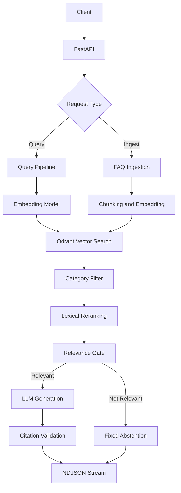

# TaskFlow Support RAG 🚀

<p align="center">
  <strong>A streaming, citation-aware support assistant powered by Retrieval-Augmented Generation.</strong>
  <br />
  Built with FastAPI, Qdrant, Sentence Transformers, and an OpenAI-compatible LLM endpoint.
</p>

<p align="center">
  
  
  
  
  
</p>

---

## 📌 Overview

TaskFlow Support RAG is a backend support assistant built over a fictional **40-entry TaskFlow FAQ corpus**.

It retrieves relevant FAQ content, filters weak matches, and generates answers grounded in retrieved information.

Unlike a basic LLM chatbot, the system:

- Retrieves relevant FAQ chunks using vector similarity.
- Supports category-based filtering.
- Applies a lexical reranking step to improve candidate selection.
- Uses a configurable relevance threshold to reject weak matches.
- Streams answers through newline-delimited JSON (NDJSON).
- Tracks the sources retrieved and citations used in the final answer.
- Abstains when the retrieved content is not relevant enough.

The goal is to build a support system that gives useful answers without inventing information.

## ✨ Key Features

| Feature | Description |
|---|---|
| Semantic retrieval | Qdrant cosine similarity search |
| Category filtering | Optional indexed category filter |
| Lexical reranking | Reorders candidates using lexical relevance |
| Relevance gate | Rejects results below `MIN_RELEVANCE` |
| Grounded generation | Generates answers from retrieved context |
| Citation tracking | Returns IDs actually cited by the model |
| Streaming API | Streams sources, answer deltas, and final response |
| FAQ ingestion | Adds or replaces FAQ entries by ID |
| Idempotency | Deterministic UUID5 chunk IDs prevent duplicate points |
| Evaluation | Measures retrieval and generation quality |
| Automated tests | Covers retrieval, filtering, ingestion, and abstention |

## 🏗️ Architecture



### Query flow

1. The client sends a question to `/query`.
2. The question is converted into an embedding.
3. Qdrant retrieves similar FAQ chunks.
4. An optional category filter narrows the search.
5. Lexical reranking adjusts candidate relevance.
6. The relevance gate checks the best available results.
7. Relevant context is sent to the LLM.
8. The answer streams with source and citation information.
9. If retrieval fails the relevance gate, the system returns a fixed abstention without calling the LLM.

## 🛠️ Tech Stack

| Technology | Purpose |
|---|---|
| Python 3.11+ | Backend development |
| FastAPI | REST API and streaming |
| Qdrant | Vector database |
| Sentence Transformers | Text embeddings |
| OpenAI-compatible API | LLM generation |
| Pydantic | Request and response validation |
| Docker Compose | Local Qdrant setup |
| Pytest | Automated testing |

## 📂 Project Structure

```text
Ticket-Support-System-fixed/
│
├── corpus/
│   ├── faqs.json
│   └── corpus.md
│
├── evaluation/
│   └── questions.json
│
├── test/
│   └── test_rag.py
│
├── test_runs/
│
├── main.py
├── retrieval.py
├── generator.py
├── ingest.py
├── raw_search.py
├── retrieval_compare.py
├── evaluate.py
│
├── requirements.txt
├── docker-compose.yml
├── pytest.ini
├── .env.example
├── .gitignore
├── README.md
├── SETUP.md
├── evaluation.md
└── retrieval-notes.md
```

## ⚙️ Getting Started

### Prerequisites

- Python 3.11 or later
- Docker and Docker Compose
- An API key for the configured OpenAI-compatible Groq endpoint

### 1. Clone the repository

```bash
git clone https://github.com/srivatsan-droid/Support-Ticket-System-.git

cd Support-Ticket-System-
```

### 2. Create a virtual environment

```bash
python3.11 -m venv .venv

source .venv/bin/activate
```

### 3. Install dependencies

```bash
pip install -r requirements.txt
```

### 4. Configure environment variables

```bash
cp .env.example .env
```

Add your provider API key and required settings to `.env`.

**Never commit your `.env` file or API keys.**

### 5. Start Qdrant

```bash
docker compose up -d qdrant
```

### 6. Ingest the FAQ corpus

```bash
python ingest.py
```

Ingestion can be repeated safely. Existing source entries are replaced by ID, and deterministic UUID5 chunk IDs prevent duplicate vector points.

### 7. Start the API

```bash
uvicorn main:app --reload
```

The API will be available at:

```text
http://localhost:8000
```

Interactive API documentation:

```text
http://localhost:8000/docs
```

## 🔌 API Reference

### 1. Query Endpoint

`POST /query`

Accepts a question and streams the generated response as NDJSON.

**Request**

```bash
curl -N -X POST http://localhost:8000/query \
  -H "Content-Type: application/json" \
  -d '{"question":"How do I reset my password?"}'
```

**Response event flow**

The response contains three event types:

| Event | Purpose |
|---|---|
| `sources` | Retrieved chunks provided to the model |
| `delta` | Incremental answer text |
| `final` | Final answer and validated citations |

Example response shape:

```json
{"type":"sources","retrieved_sources":[...]}
{"type":"delta","content":"You can reset your password..."}
{"type":"final","answer":"...","cited_sources":["faq-001"]}
```

The final event follows the `QueryResponse` Pydantic schema.

**Citation validation**

- The model cites sources using bracketed IDs.
- The backend extracts IDs cited in the answer.
- Citations are intersected with the retrieved source IDs.
- Only valid retrieved IDs appear in `cited_sources`.

**Abstention behavior**

When no retrieved result meets `MIN_RELEVANCE`, the system:

- Skips LLM generation.
- Returns a fixed abstention response.
- Does not invent an answer from unrelated FAQ entries.

### 2. FAQ Ingestion Endpoint

`POST /ingest`

Adds or replaces FAQ entries.

**Request fields**

| Field | Description |
|---|---|
| `id` | Unique FAQ identifier |
| `title` | FAQ title |
| `body` | FAQ content |
| `category` | FAQ category |
| `last_updated` | ISO-formatted update date |

The ingestion path uses the same ID-based replacement and deterministic chunk ID strategy as corpus ingestion.

## 🧠 Retrieval Design

The retrieval pipeline combines semantic similarity with lexical relevance.

### Semantic search

- Converts the question into an embedding.
- Searches Qdrant using cosine similarity.
- Supports an optional indexed category filter.

### Lexical reranking

Retrieved candidates are adjusted using lexical overlap.

This helps distinguish candidates that have similar meanings but differ in important query terms.

### Relevance gate

The `MIN_RELEVANCE` setting controls whether retrieved content is strong enough to support an answer.

The current calibrated value is:

```env
MIN_RELEVANCE=0.42
```

The threshold is checked against the actual embedding-based evaluation, not only mocked unit tests.

### Retrieval comparison

See [`retrieval-notes.md`](retrieval-notes.md) for the retrieval comparison and documented improvement example.

## 📊 Evaluation

The project includes an evaluation dataset with answerable and deliberately unanswerable questions.

### Run evaluation

```bash
python evaluate.py
```

This evaluates the real retrieval pipeline against Qdrant.

### Run relevance calibration checks

```bash
python evaluate.py --check
```

This checks score calibration and abstention behavior using the configured embedding model.

### Run generation evaluation

```bash
python evaluate.py --generate --judge
```

This adds citation precision and LLM-judged faithfulness evaluation.

### Reported evaluation results

| Metric | Result |
|---|---:|
| Context recall | 1.000 |
| Context precision | 0.9074 |
| Abstention rate | 1.000 |
| Citation precision | 1.000 |
| Leaked unanswerables | 0 |

These are results from the reported evaluation run. Results can vary with model, data, and configuration changes.

For the evaluation methodology and full details, see [`evaluation.md`](evaluation.md).

## 🧪 Testing

Run the test suite:

```bash
pytest -q
```

**Reported test results:**

```text
19 passed, 1 xfailed
```

The test suite uses:

- An in-memory Qdrant instance.
- An offline stand-in encoder.
- Real retrieval, filtering, idempotency, and abstention logic.
- A mocked LLM to avoid external generation calls during tests.

The expected failure is a documented known limitation in an unanswerable-question test. Real embedding-based score calibration is checked separately with:

```bash
python evaluate.py --check
```

## 🔍 Review Artifacts

| File | Purpose |
|---|---|
| [`corpus/faqs.json`](corpus/faqs.json) | FAQ source data |
| [`corpus/corpus.md`](corpus/corpus.md) | Corpus documentation |
| [`retrieval-notes.md`](retrieval-notes.md) | Retrieval comparison |
| [`evaluation/questions.json`](evaluation/questions.json) | Evaluation questions |
| [`evaluation.md`](evaluation.md) | Evaluation methodology and results |
| [`evaluate.py`](evaluate.py) | Evaluation runner |
| [`SETUP.md`](SETUP.md) | Additional setup instructions |

## 🚧 Known Limitations

- The FAQ corpus is fictional and limited to 40 entries.
- Retrieval quality depends on the embedding model and relevance threshold.
- The lexical reranker is simpler than a learned cross-encoder.
- LLM output quality depends on the configured provider.
- The test suite includes one expected failure for a known retrieval-gate limitation.

These are known trade-offs and areas for future improvement.

## 🔮 Future Improvements

- Add a learned cross-encoder reranker.
- Explore stronger hybrid retrieval with sparse and dense search.
- Add query rewriting for difficult questions.
- Add authentication and role-based access for ingestion.
- Add structured logging and request tracing.
- Expand the FAQ corpus and evaluation dataset.
- Add load testing for concurrent streaming requests.

## 👨‍💻 Author

**Srivatsan**

Software Engineer | Backend Development

[GitHub](https://github.com/srivatsan-droid)

---

<p align="center">
  <strong>Built to make support answers more relevant, traceable, and reliable.</strong>
  <br />
  <sub>TaskFlow Support RAG — Retrieval first. Grounded answers. Clear citations.</sub>
</p>
